# How Ravex Support works

This document walks through the whole platform: who uses it, what happens on every important action, and where each step lives in the code. Diagrams are written in [Mermaid](https://mermaid.js.org/), which GitHub renders automatically.

**Contents**

1. [The platform in one minute](#1-the-platform-in-one-minute)
2. [Architecture](#2-architecture)
3. [Roles and permissions](#3-roles-and-permissions)
4. [Data model](#4-data-model)
5. [A conversation from start to finish](#5-a-conversation-from-start-to-finish)
6. [Flows in detail](#6-flows-in-detail)
7. [Conversation lifecycle](#7-conversation-lifecycle)
8. [Realtime rooms](#8-realtime-rooms)
9. [Frontend structure](#9-frontend-structure)
10. [Security layers](#10-security-layers)
11. [Limits and error codes](#11-limits-and-error-codes)
12. [Where to find things in the code](#12-where-to-find-things-in-the-code)
13. [Deployment](#13-deployment)

---

## 1. The platform in one minute

Ravex Support is a live customer-support desk, similar to Intercom or Zendesk chat.

- **Customers** open a conversation ("My invoice was charged twice"), and an agent joins them in real time.
- **Agents** watch a live queue, accept conversations (the first agent to accept gets it), and chat with the customer.
- **Admins** see the whole desk: statistics, every conversation, user and agent management, and departments.

Three systems split the work:

| System | Responsibility |
|---|---|
| **PostgreSQL** (Neon, via Prisma) | Everything that must survive: users, conversations, messages, read receipts, reactions, attachment metadata |
| **Ravex** (on Socket.IO) | Everything live: delivering messages instantly, presence, typing indicators, read-receipt and reaction events |
| **Cloudinary** | The actual uploaded files (images, PDFs, documents) |

**The golden rule:** a message is **saved to PostgreSQL first, and only then delivered** through Ravex. Nothing a user sees live can be missing from the history.

---

## 2. Architecture

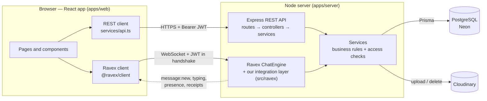

Both entry points (REST and WebSocket) go through the **same services**, so the rules are identical no matter how a request arrives. For example, `message.service.createMessage` is used by the REST endpoint *and* by Ravex's `message:send`.

The services never import Ravex directly. They talk to a small **realtime gateway** interface (`services/realtime.ts`), and `src/ravex` implements it. That keeps Ravex isolated in one folder.

---

## 3. Roles and permissions

Roles are stored in the database and **re-read on every request and every socket connection**. The browser never decides anyone's role.

| | Customer | Agent | Admin |
|---|---|---|---|
| Register publicly | ✅ (always becomes a customer) | — (created by an admin) | — (seeded or created by an admin) |
| See conversations | Only their own | Assigned to them **plus** the unassigned queue | All |
| Open a conversation | ✅ | — | — |
| Send messages, react, mark read, upload | In their own conversations | Only after accepting (assigned) | — (read-only observer) |
| Close / reopen | Their own | Assigned ones | Any |
| Change priority / department / "pending" | — | Assigned ones | Any |
| Assign | — | Accept an unassigned one for themselves | Assign / reassign / unassign any active agent |
| Manage users, agents, departments; view stats | — | — | ✅ |

A conversation the user is not allowed to see answers **404 Not Found**, not 403. That way nobody can probe which conversation IDs exist.

---

## 4. Data model

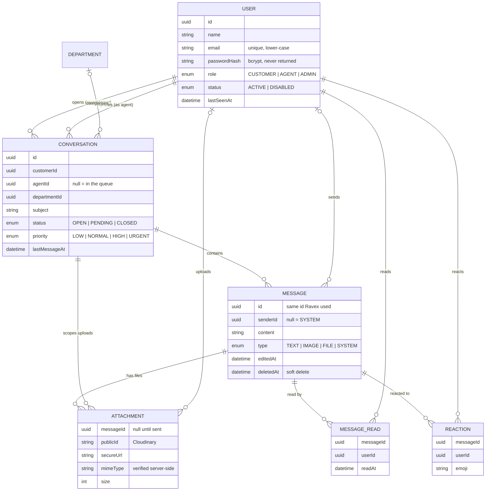

The unique constraints are: `users.email`, `departments.name`, `(messageId, userId)` on reads, and `(messageId, userId, emoji)` on reactions.

---

## 5. A conversation from start to finish

Here's the whole story, before the details:

1. **Jordan registers** at `/register`. The server creates a `CUSTOMER` and returns a JWT. The browser stores it and opens one Ravex WebSocket connection.
2. **Jordan opens a conversation**: subject "Invoice charged twice", department Billing, and a first message. It's saved in one transaction (conversation and first message together).
3. **Every agent's queue updates instantly.** The server sends a `conversation.created` notice into the `staff` room, and agents' lists refresh.
4. **Maya (an agent) clicks Accept.** The database update only succeeds if the conversation is still unassigned, so two agents can't both get it. A system message, "Maya Chen joined the conversation", is saved and broadcast. Other agents who were watching are removed from the room.
5. **They chat.** Jordan's typing shows on Maya's screen. Each message is saved, then delivered. When Maya reads it, Jordan sees **Read** under the message.
6. **Reactions, edits and deletes** are saved and broadcast the same way.
7. **Maya marks it "pending"** (waiting on the customer). When Jordan replies, it automatically goes back to **open**.
8. **Jordan closes it.** New messages are now refused until someone reopens it.
9. **The admin dashboard** reflects all of this: counts, charts and the activity feed.

---

## 6. Flows in detail

### 6.1 Register and sign in

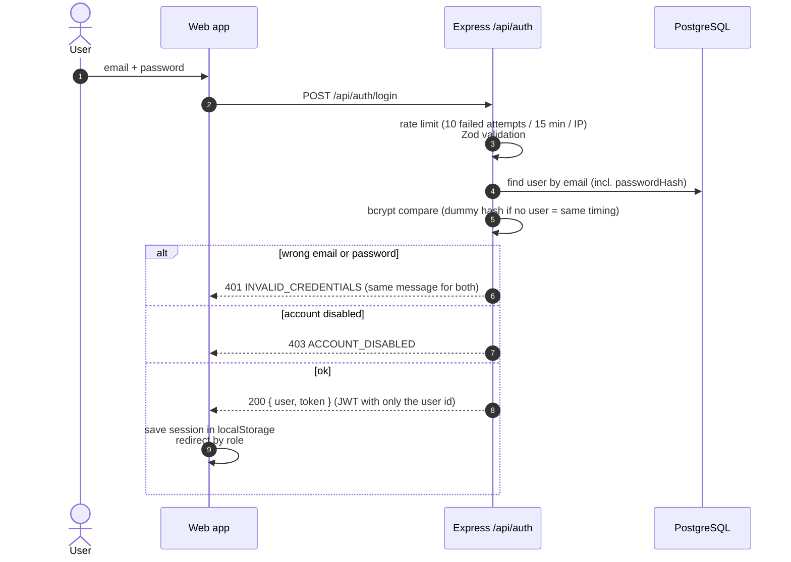

- **Register** (`POST /api/auth/register`) always creates a `CUSTOMER`, even if the request sends `"role": "ADMIN"`.
- **Every later request** sends `Authorization: Bearer <token>`. The server verifies the signature, then **loads the user from the database**, so a disabled user or a role change takes effect on the very next request, even with an old token.
- **Returning visit:** the app calls `GET /api/auth/me` to re-validate the stored session. A `401` anywhere signs the user out.
- **Where they land:** customers go to `/dashboard`, agents to `/agent/dashboard`, admins to `/admin`.

### 6.2 Opening the realtime connection

Ravex on its own trusts whatever user object the client sends. Our handshake middleware runs **before** Ravex's and replaces it:

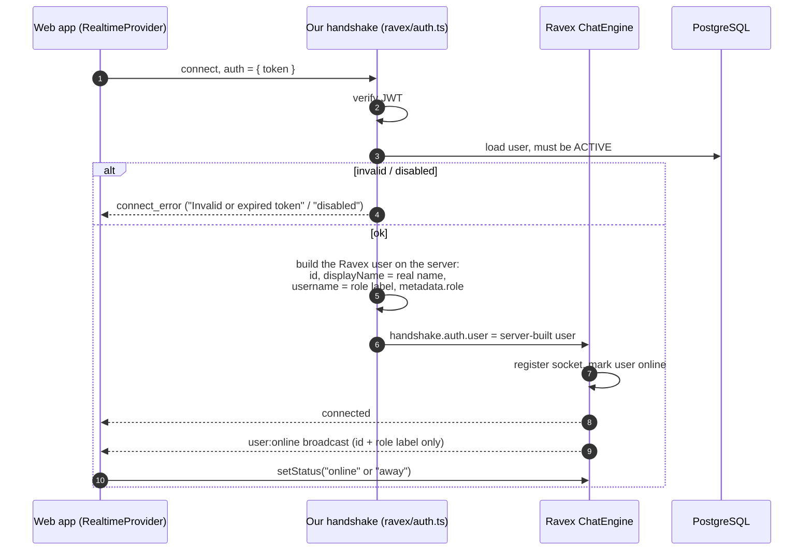

The browser keeps **one** connection for the whole session (`stores/realtime.tsx`). The header shows its state: Live, Connecting, Reconnecting or Connection error.

### 6.3 Customer opens a conversation

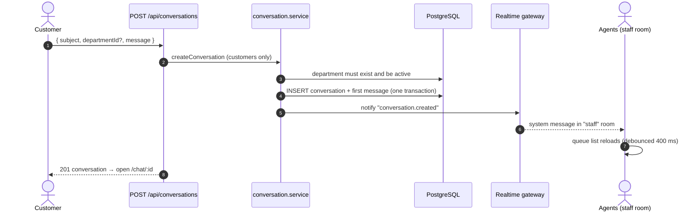

### 6.4 Agent accepts (assignment)

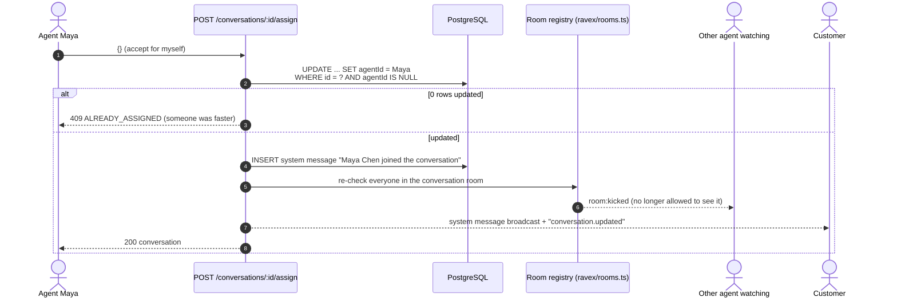

Admins use the same endpoint with `{ agentId }` to assign, reassign or unassign (`{ agentId: null }`). The agent must be an active `AGENT`.

### 6.5 Sending a message over the socket (the main path)

This is the heart of the integration. Ravex runs our **message middleware before it broadcasts**, and we save the message there:

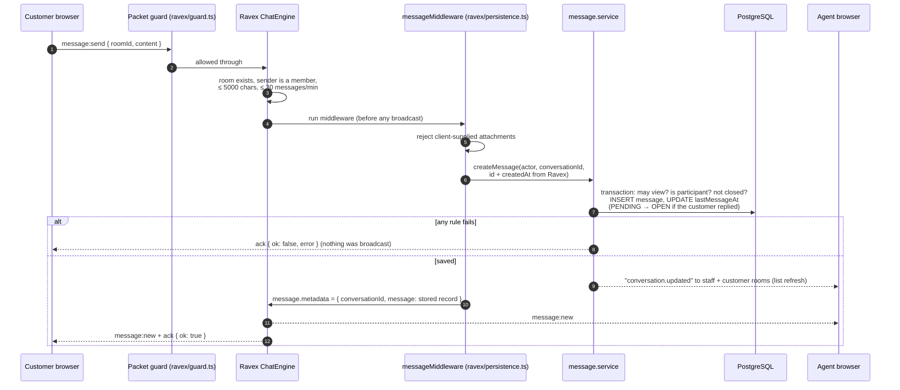

Every live message carries the **stored database record** in `metadata.message`. The browser therefore renders live messages and history with the same code.

### 6.6 Sending through REST, and uploading files

REST is used when the socket is down, and always for attachments. Files are a **two-step** flow:

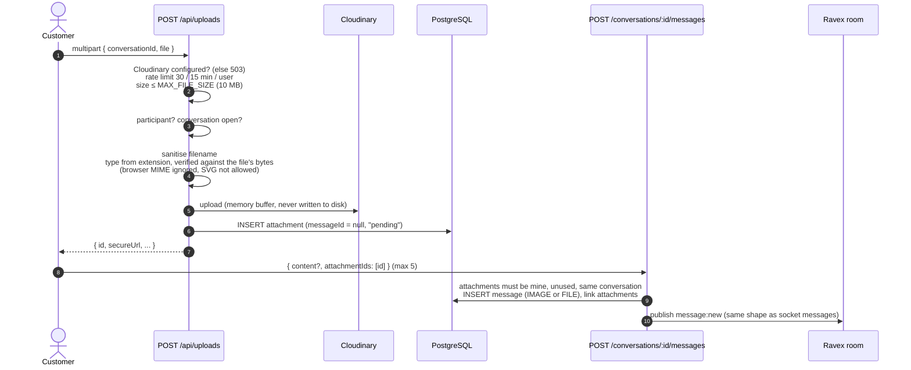

If Cloudinary credentials are missing, the upload step answers `503 UPLOADS_NOT_CONFIGURED` and the composer shows that message. Everything else keeps working.

### 6.7 Typing indicator

1. As someone types, the browser calls `startTyping(roomId)`. Ravex throttles this to one event per 300 ms.
2. **The guard checks they are a participant**, so viewers like admins or watching agents never show as typing.
3. Ravex sends `typing:start` to everyone else in the room.
4. The other side shows a braille spinner with "Jordan Lee is typing…". The name comes from the conversation record, not from Ravex, whose username is only a role label.
5. It stops on `typing:stop` when the person sends, clears the box or leaves the field, when a message from them arrives, or after **3 s** without typing (Ravex's auto-stop).

Typing is never stored.

### 6.8 Read receipts

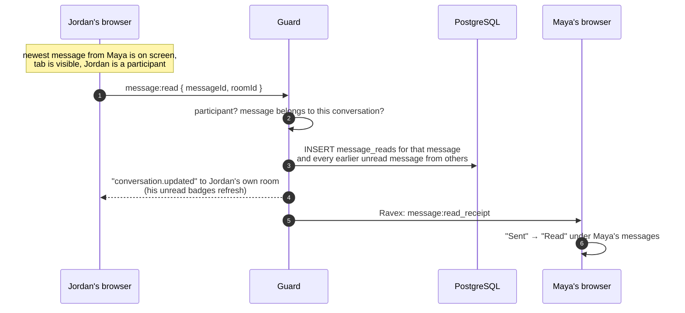

- **Statuses:** a message shows **Sent** once it's stored and **Read** once a receipt exists.
- **No "Delivered":** Ravex 0.1.1 has no delivery event, so that status isn't shown.
- **Unread counts:** each conversation in a list carries an `unreadCount`, meaning messages from others that the viewer hasn't read.

### 6.9 Reactions

1. Hover a message (or tap it on a phone) and pick 👍 ❤️ 😂 😮 or 😢.
2. The guard checks: participant, emoji on the allowed list, message in this conversation, not deleted, not a system message.
3. The database **toggles** the reaction: it's added if absent, removed if present.
4. Ravex broadcasts `message:reaction`. The event doesn't say "added" or "removed", so every browser toggles it the same way the database did.

### 6.10 Edits and deletes

- **Edit:** only your own `TEXT` messages, in an open conversation, with new content of 1–5000 characters. The database saves the content and `editedAt`, then Ravex broadcasts `message:edited`. The bubble shows "· edited".
- **Delete:** only your own messages. It's a **soft delete** (`deletedAt`), and Ravex broadcasts `message:deleted`. History then returns a tombstone ("This message was deleted"), with no content, attachments or reactions.

### 6.11 Presence (online, away, offline)

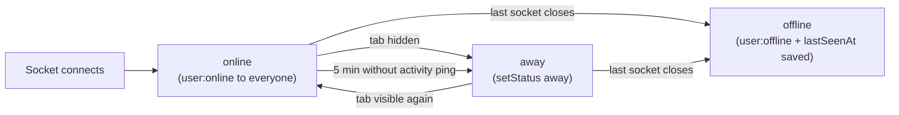

- The browser pings at most once a minute while you click or type, which resets Ravex's 5-minute away timer.
- **Privacy:** Ravex announces presence to every connected socket. We therefore give Ravex only a role label as the username, and real names only travel inside rooms the person is part of.
- REST responses include each participant's current `presence`, so a freshly loaded page is correct straight away. Live events keep it up to date.
- When someone is offline, the chat header shows "last seen 5 minutes ago", from `lastSeenAt`.

### 6.12 Live lists, queues and badges

Lists don't poll. The server drops small **notices** into notification rooms:

| Room | Who listens | When it gets a notice |
|---|---|---|
| `staff` | Agents and admins | A conversation is created, assigned or changes status, or gets a message while still unassigned |
| `user:<id>` | That one user | A conversation they take part in (customer, or assigned agent) changed, or they read something (unread counts) |

Messages in an assigned conversation only notify its two participants. Staff lists therefore aren't reloaded for every message on the desk, and agents don't learn about other agents' traffic.

A notice is a Ravex `system` message carrying `{ event: "conversation.created" | "conversation.updated", conversationId }`. Lists wait **400 ms** to batch bursts, then refetch through REST. That refetch also re-applies all permission rules, so a notice never leaks data.

### 6.13 Admin actions

- **Change a user's role, or disable them:**
  1. The database is updated.
  2. A demoted or disabled agent's open conversations go back to the queue.
  3. The user is removed from every live room and their sockets are disconnected.
  4. Their next REST request answers `403 ACCOUNT_DISABLED`, or applies the new role.

  Admins can't change their own role or status, so nobody can lock the last admin out.
- **Create staff accounts:** name, email, temporary password and role.
- **Departments:** create, rename, deactivate (hidden from customers) or delete. Deleting keeps the conversations and clears their department.
- **Dashboard:**
  - totals: customers, agents, agents online right now, open, pending and closed conversations, messages today;
  - 14-day charts of new conversations and messages;
  - an activity feed: new conversations, system events and sign-ups.

### 6.14 Reconnects and server restarts

- **If the connection drops,** the header shows *Reconnecting*. On reconnect the browser **re-joins every room it was using**, then **re-fetches the latest messages**, so anything sent meanwhile appears.
- **Ravex keeps rooms in memory only.** After a server restart, rooms are rebuilt the first time someone joins, with new Ravex room IDs. Clients don't notice, because they join by logical key (`conversation:<id>`) rather than by Ravex's ID.

---

## 7. Conversation lifecycle

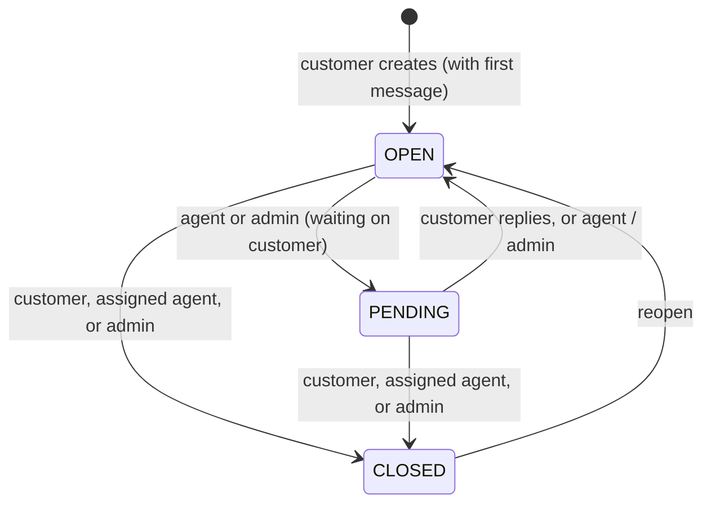

Assignment is a separate axis: **unassigned** (in the queue) ↔ **assigned** to one agent.

| Rule | Effect |
|---|---|
| `CLOSED` | Messages, uploads and assignment are refused (`409 CONVERSATION_CLOSED`) until it's reopened |
| Status change | Saves and broadcasts a system message, e.g. "Maya Chen marked the conversation as pending" |
| Customer reply to `PENDING` | Automatically back to `OPEN` |

---

## 8. Realtime rooms

Clients ask for **logical keys**. The server checks access in PostgreSQL, creates the Ravex room lazily, and hands back Ravex's real room ID:

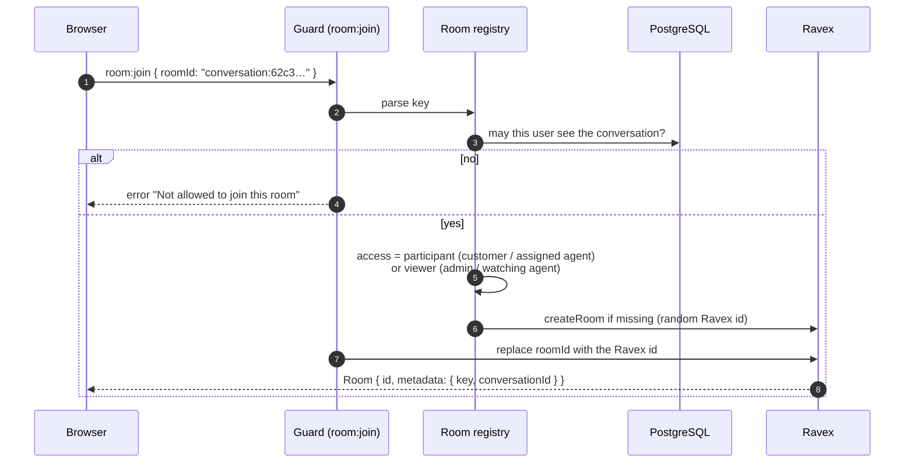

| Key | Who may join | Access |
|---|---|---|
| `conversation:<id>` | Anyone allowed to view that conversation | **Participant** (customer, assigned agent): can send, type, react, read, edit, delete. **Viewer** (admin, watching agent): receives only |
| `staff` | Agents and admins | Receives notices |
| `user:<id>` | That user only | Receives notices |

Clients can never create or delete rooms. The guard only lets through the events the app uses, with the right shape: an object payload, and a callback where Ravex expects one. Everything else is dropped, including `room:create`, `room:delete`, `room:list`, `room:members` and `message:history`. This also protects availability: Ravex 0.1.1 would crash the process on, for example, a `room:list` without a callback.

**Leaving is per socket.** Ravex's own `room:leave` removes the *user*, which would break the same user's other tabs. The guard handles it instead: only the leaving tab stops receiving the room, and the user's access record stays, so a later revocation still kicks every tab.

---

## 9. Frontend structure

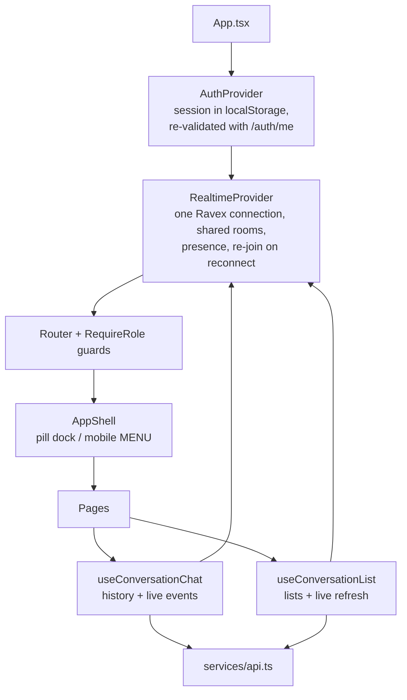

| Role | Routes |
|---|---|
| Anyone | `/` (landing page; signed-in users are sent to their portal), `/login`, `/register` |
| Customer | `/dashboard` (new conversation + list), `/chat/:conversationId`, `/profile` |
| Agent | `/agent/dashboard` (metrics + live queue), `/agent/conversations` (search and filters), `/agent/conversations/:id`, `/agent/profile` |
| Admin | `/admin` (overview), `/admin/conversations[/:id]`, `/admin/users`, `/admin/agents`, `/admin/departments`, `/admin/profile` |

**How a chat screen works** (`hooks/useConversationChat.ts`):

1. **Load:** it fetches the conversation and the newest 30 messages over REST, then joins `conversation:<id>`.
2. **Live updates:** new messages, edits, deletes, reactions and receipts are merged in by message ID, so a message is never shown twice.
3. **Older history:** "Load older messages" pages backwards with a cursor and keeps your scroll position.
4. **Read receipts:** sent when the newest messages are on screen and the tab is visible.
5. **Out-of-order responses:** they can't overwrite newer data. The conversation is only replaced by a snapshot with an equal or newer `updatedAt`.

The guards in the browser only decide what to display. **The server enforces every rule again.**

---

## 10. Security layers

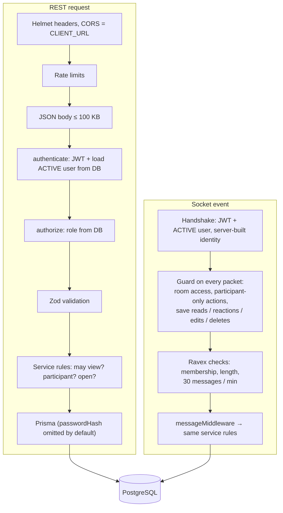

- **Passwords:** bcrypt at cost 12. Passwords are limited to 72 bytes (bcrypt's input limit), and failed logins take the same time whether or not the email exists.
- **Secrets:** `DATABASE_URL`, `JWT_SECRET` and `CLOUDINARY_API_SECRET` exist only on the server. The browser only knows the API and Ravex URLs.
- **Uploads:**
  - the type is decided from the file's actual bytes, not from what the browser claims;
  - SVG is not accepted;
  - file names are cleaned, and Cloudinary IDs are random;
  - an upload can only be attached by the person who uploaded it, in the same conversation, and only once.

---

## 11. Limits and error codes

| Limit | Value |
|---|---|
| Failed logins | 10 per 15 min per IP (successful logins don't count) |
| Registrations | 20 per hour per IP |
| API requests | 1,000 per 15 min per IP |
| Uploads | 30 per 15 min per user, 10 MB each (`MAX_FILE_SIZE`) |
| Realtime messages | 30 per minute per user (Ravex) |
| Socket events that touch the database | 30 burst, then 5 per second per connection |
| Message length | 5,000 characters |
| Attachments per message | 5 |
| Request body / socket packet | 100 KB |

Every error has the same shape: `{ "success": false, "message": "...", "error": "CODE" }`.

| Code | HTTP | Meaning |
|---|---|---|
| `VALIDATION_ERROR` | 400 | Bad input (`details` lists each field) |
| `INVALID_JSON`, `INVALID_CURSOR`, `INVALID_ATTACHMENT`, `INVALID_FILE_TYPE`, `INVALID_DEPARTMENT`, `INVALID_AGENT` | 400 | The specific input is wrong |
| `UNAUTHORIZED`, `INVALID_CREDENTIALS` | 401 | Not signed in, bad token, or wrong email/password |
| `FORBIDDEN`, `NOT_ASSIGNED`, `ACCOUNT_DISABLED` | 403 | Not allowed (agents must accept before replying) |
| `CONVERSATION_NOT_FOUND`, `MESSAGE_NOT_FOUND`, `USER_NOT_FOUND`, `ROUTE_NOT_FOUND` | 404 | Doesn't exist, or you may not see it |
| `EMAIL_TAKEN`, `ALREADY_ASSIGNED`, `CONVERSATION_CLOSED`, `DEPARTMENT_EXISTS` | 409 | Conflicts with the current state |
| `FILE_TOO_LARGE` | 413 | Upload over the size limit |
| `RATE_LIMITED` | 429 | Slow down |
| `UPLOAD_FAILED` | 502 | Cloudinary didn't accept the file |
| `UPLOADS_NOT_CONFIGURED` | 503 | Cloudinary credentials not set |

Socket acknowledgements use Ravex's shape, `{ ok: false, error: { code, message } }`, with the same human-readable messages.

---

## 12. Where to find things in the code

| Flow | Server | Web |
|---|---|---|
| Sign up / sign in | `routes/auth.routes.ts`, `services/auth.service.ts`, `utils/jwt.ts`, `utils/password.ts` | `stores/auth.tsx`, `pages/auth/AuthPages.tsx` |
| Socket handshake | `ravex/auth.ts` | `stores/realtime.tsx` |
| Rooms and access | `ravex/rooms.ts`, `ravex/guard.ts` | `useRoom` in `stores/realtime.tsx` |
| Conversations | `services/conversation.service.ts` | `hooks/useConversationList.ts`, `pages/*` |
| Messages (socket) | `ravex/persistence.ts` → `services/message.service.ts` | `hooks/useConversationChat.ts` |
| Messages (REST), publishing | `services/message.service.ts`, `ravex/index.ts` (gateway) | `services/api.ts` |
| Typing, reads, reactions, edits | `ravex/guard.ts` → `services/message.service.ts` | `hooks/useConversationChat.ts`, `components/chat/*` |
| Presence, last seen | `ravex/index.ts` (`presenceOf`), `services/user.service.ts` | `stores/realtime.tsx` (`usePresence`) |
| Uploads | `routes/upload.routes.ts`, `services/upload.service.ts`, `cloudinary/index.ts`, `utils/files.ts` | `components/chat/Composer.tsx` |
| Admin | `services/user.service.ts`, `services/admin.service.ts`, `services/department.service.ts` | `pages/admin/AdminPages.tsx` |
| Security | `app.ts`, `middleware/*`, `schemas/*` | — |
| Tests | `src/**/*.test.ts` (API, realtime, uploads, admin) | `e2e/smoke.mjs` (real Chrome, 3 users) |

All server paths are under `apps/server/src`; all web paths are under `apps/web/src` (except `e2e/`).

---

## 13. Deployment

Planned production topology (Phases 9–10):

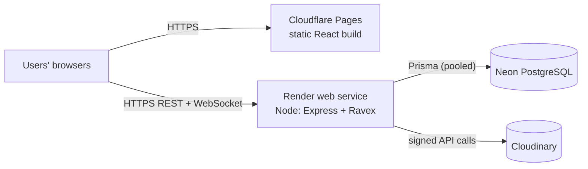

- **Frontend:** a static build on Cloudflare Pages. `public/_redirects` sends every route to `index.html`.
- **Backend:** a single Render instance. Ravex rooms and presence live in that process's memory. Running several instances later would need the Socket.IO Redis adapter and shared room state.
- **Database:** Neon. The app uses the pooled URL; migrations use the direct URL.
- **Files:** Cloudinary only. Render's disk is temporary, so files are never stored there.
